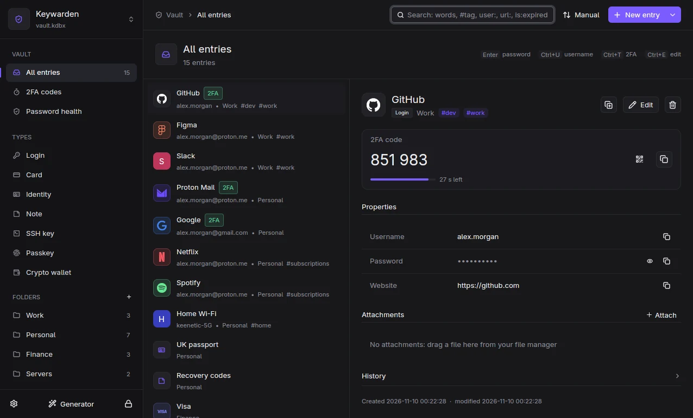

# Keywarden

**English** · [Русский](README.ru.md) · [Website & docs](https://onokashino.github.io/keywarden/)

A fast, keyboard-first password manager built on the KeePass format (KDBX 4) for Linux,
Windows and macOS. Your database stays a plain `.kdbx` file: KeePassXC, KeePassDX and
KeePassium open it without conversion, and any file sync (Syncthing, Nextcloud, Dropbox)
keeps your devices in step.



## Highlights

- **Launcher**: a hotkey opens a search box over any window, Enter copies the password,
  Ctrl+U the username, Ctrl+T the 2FA code. The clipboard is marked secret and cleared after 30 s.
- **Real KeePass compatibility**: every save is written, decrypted back and compared before
  it replaces the file; a backup is kept for each write; external edits are merged, not overwritten.
- **Browser extension** for Firefox and Chromium: autofill, 2FA, saving new passwords, passkeys
  stored in the KeePassXC format. Every new site is confirmed in a Keywarden window.
- **Entry types**: login, card, identity, note, SSH key, passkey, crypto wallet.
- **2FA codes** like an authenticator app, with QR import and `.2fas` import and export.
- **SSH agent** with per-use confirmation and `kw ssh`, a terminal server picker by vault folder; **autotype**, **password health** (weak, reused,
  Have I Been Pwned with k-anonymity), Secret Service replacement on Linux.
- **Hardened by default**: secrets are zeroized, the process refuses core dumps and debuggers,
  local sockets accept only your own user.

## Install

Download an archive for your system from [Releases](https://github.com/onokashino/keywarden/releases):

| System | Archive | Next step |
| --- | --- | --- |
| Linux x86_64 | `keywarden-*-linux-x86_64.tar.gz` | `./install.sh` (installs to `~/.local/bin`, no root) |
| Windows x86_64 | `keywarden-*-windows-x86_64.zip` | unpack, run `keywarden-ui.exe` |
| macOS (Apple Silicon) | `keywarden-*-macos-arm64.tar.gz` | `xattr -dr com.apple.quarantine keywarden-*` then run `keywarden-ui` |

Then connect the browser extension with `kw browser-setup`. Full guide:
[onokashino.github.io/keywarden/docs](https://onokashino.github.io/keywarden/docs/).

## Building from source

Rust 1.92+ is required. On Linux install the GPUI system libraries first
(`libxkbcommon`, `wayland`, `vulkan`, `fontconfig`).

```sh
cargo build --release -p keywarden-daemon -p keywarden-cli -p keywarden-host -p keywarden-ui
```

The project's own checks run in Docker; see [CONTRIBUTING.md](CONTRIBUTING.md).

## Translations

Keywarden speaks English and Russian, and any language can be added without touching the code:
see [docs/translating.md](docs/translating.md).

## Security

Please report vulnerabilities privately, see [SECURITY.md](SECURITY.md).

## License

[GPL-3.0-or-later](LICENSE).
